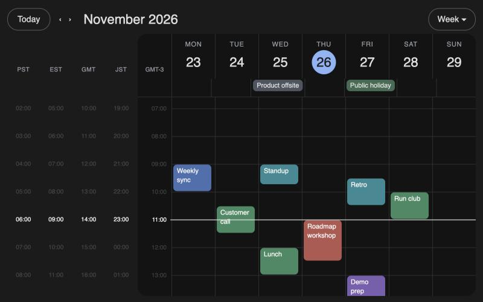
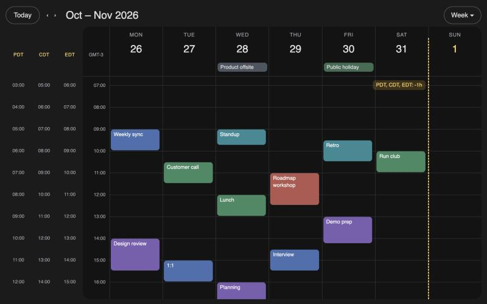
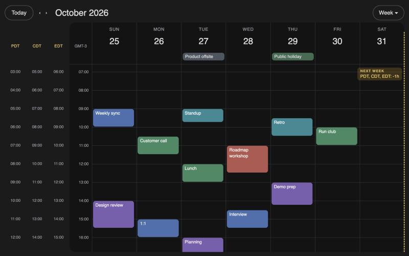

# World Time for Google Calendar

A Chrome extension that adds extra timezone columns to the left of the Google Calendar
time grid (Day / Week views), laid out like Notion Calendar. Your calendar's own timezone
column stays Google's.

```
 PST   CST   EST  │ MVD
20:00 22:00 23:00 │ 01:00
21:00 23:00 00:00 │ 02:00
```

## Screenshots

*(Rendered from `test/demo.html` with made-up events, running the real extension script.)*

### Row hover

Hover any row in the extra columns: that hour lights up across every timezone, including Google's own
column, the other rows fade back, and a thin line marks that hour across the calendar grid (drawn on top of Google's own
line, and switchable in the popup), so you can read one moment across the world at a glance.



### Daylight saving notices

In a week where a clock changes, a dashed amber line marks the first day with the new offset, the chip
says how much the affected zones shift (`-1h` here: US clocks go back on Sunday 1 Nov 2026), and the
affected headings turn amber. The columns are exact for the days before the line; for the days after it,
apply the chip's amount to the time shown (here, one hour earlier).



If the change lands on the day right after the visible week, the same flag appears at the right edge with
a **NEXT WEEK** label, so you see it coming before you get there.



Turn these notices off with the **Daylight saving notices** switch in the popup.

## Features

- **Any number of timezones**, reorderable, with editable headings (auto-abbreviated: PST/PDT, BST, JST …).
- **Aligned to Google's own hour labels** through scrolling, the all-day row, sidebar toggling,
  density changes and week navigation. Works in light and dark mode.
- **Row hover:** hover a row and its times brighten across every column while the others fade.
- **Current-time pill** anchored to Google's red "now" line.
- **Daylight-saving hints:** in a week where a zone's clock changes, a dashed amber line marks the
  first affected day, with a chip like `PDT, CDT, EDT: -1h`, and the affected zone headings turn amber.
  When the change lands on the day right after the visible week, the same flag appears at the right
  edge with a "NEXT WEEK" eyebrow. Toggle it in the popup.
- **Timezone mismatch warning:** the popup compares Google's red now-line with the clock in the timezone
  the extension assumes. If your Google Calendar timezone differs from your computer's, a chip says so
  and offers one-click fixes.
- 12/24-hour clock, optional calendar-timezone override, enable/disable switch.

## Install (unpacked)

1. Open `chrome://extensions` and enable **Developer mode**.
2. **Load unpacked** and select this folder.
3. Reload any open Google Calendar tab, then click the extension icon to add timezones.

## How it works

Google Calendar's class names are obfuscated and change often, so nothing depends on them.
The content script finds the hour-label column by content (a run of ~23 consecutive hours),
measures each label's real on-screen position every frame while the layout is moving, and draws
the extra columns at exactly those positions. The calendar is shifted with a CSS rule on
`<html class="gtz-on">` so a freshly rendered grid is shifted from its first paint.

## Known limits

- Calendar has one gutter per week, so a week that crosses a DST change shows the conversion in
  force at the start of the week; the amber line and chip mark where it changes.
- "Calendar timezone: Auto" means your browser's timezone. If Google Calendar's own timezone setting
  differs, the popup shows a warning chip (it needs today's red now-line on screen to check) with
  suggested timezones; pick the right one there or in the dropdown.

## Troubleshooting

If the columns look misaligned after a Google Calendar update, the detection lives in `content.js`
(`findLabels`, `findTzCaption`, `findDayHeaders`). It works from the page's content rather than Google's class
names, so it usually survives redesigns, but those three functions are where to look. `test/demo.html` is a
quick way to check the behaviour without a real calendar.

## Publishing to the Chrome Web Store

`./package.sh` builds `dist/world-time-for-google-calendar-<version>.zip` containing only the files the
extension needs at runtime (the manifest, content script, popup and icons). `store/listing.md` has the
listing text, permission justifications and privacy disclosures to paste into the developer dashboard, and
`store/` holds the 640x400 screenshots. Bump `version` in `manifest.json` before each upload.

## Development

- `test/demo.html` is the page the README screenshots come from: open `/test/demo.html?s=hover|dst|next&compact=1`
  (viewport ~1024x640) with the folder served by `python3 -m http.server`. It uses made-up events.
- `test/popup-test.html` renders the real popup with a faked `chrome.*` API (same server, `/test/popup-test.html`).
- `test/mock2.html` is a stand-in page for exercising the content script without Google Calendar
  (serve the folder with `python3 -m http.server` and open `/test/mock2.html`).
- `make_icons.py` regenerates `icons/icon{16,32,48,128}.png` from `icons/source.svg` (macOS only: it uses
  Quick Look and `sips`, rendering on black and on white to recover true transparency).
